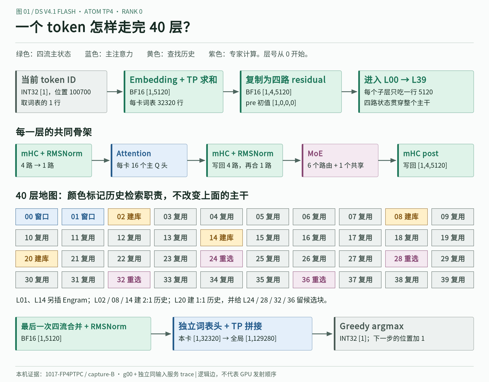
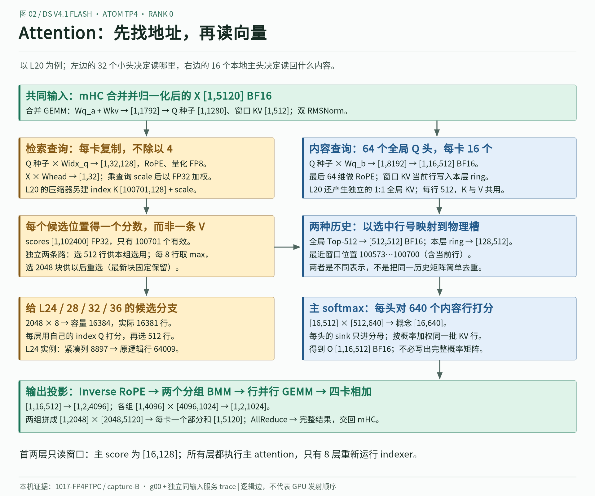
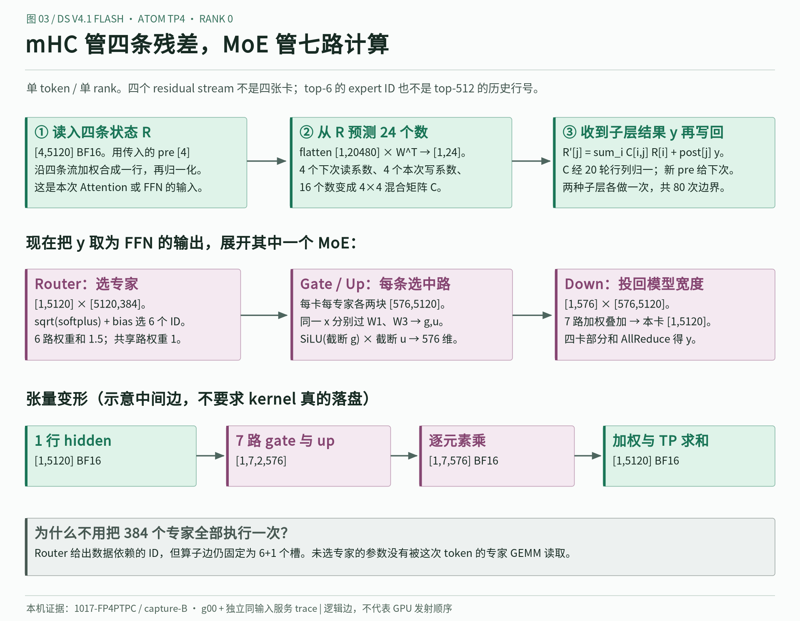
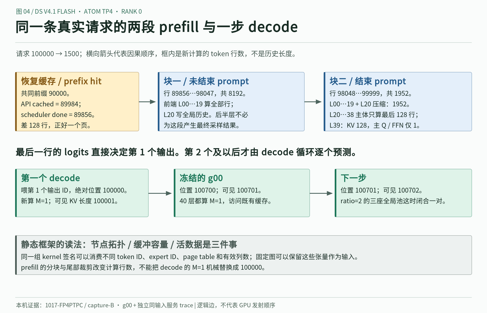
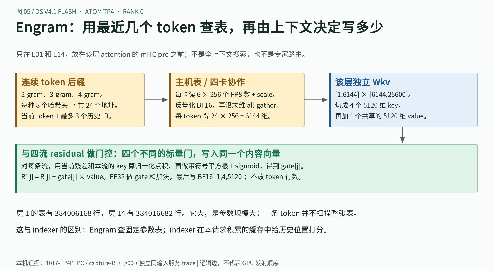

# DeepSeek V4.1 Flash：一个 token 的静态推理图册

这是 **DeepSeek‑V4.1‑Flash‑1017‑FP4PTPC** 在 **ATOM / MI308X × 4 / TP4** 上的一份中文读图指南。主图固定在一次真实的文本 decode：位置 **100700**，本步只有 **1** 个新 token，含当前行的可见历史为 **100701**。图中默认给 rank 0 的尺寸；层号从 0 起。

**[阅读全文：从输入、40 层计算到词表输出，附 shape、dtype 和手算例子](operators/dsv41-flash-tp4/README.md)**

| 想查什么 | 入口 |
|---|---|
| 放大看单张图 | [① 全模型](operators/dsv41-flash-tp4/figures/01-overview.png) · [② Attention](operators/dsv41-flash-tp4/figures/02-attention.png) · [③ mHC 与 MoE](operators/dsv41-flash-tp4/figures/03-mhc-moe.png) · [④ Prefill 与 Decode](operators/dsv41-flash-tp4/figures/04-prefill.png) · [⑤ Engram](operators/dsv41-flash-tp4/figures/05-engram.png) |
| 查某一层的输入、输出、dtype | [逐节点算子表（TSV）](operators/dsv41-flash-tp4/operators.tsv) |
| 用静态图查看器逐节点浏览 | [Decode：完整 40 层 ONNX](operators/dsv41-flash-tp4/decode-g00-rank0.onnx) · [Prefill：两段固定形状 ONNX](operators/dsv41-flash-tp4/prefill-shapes.onnx) |

## ① 从一个 ID 走完 40 层

Embedding 取出一行 BF16 `[1,5120]`，复制为四条残差流 `[1,4,5120]`。所有 40 层都有主 attention 和 MoE，但只有 8 层给长期历史重新打分。图中“建库、重选、复用”标记的是**历史由谁提供**，不是这个 block 要不要执行。最后合并四流，词表头才输出 `[1,129280]`。

## ② Attention：找地址和读内容是两套计算

32 个索引小头决定**读哪些历史行**。每卡 16 个主 Q 头决定**从这些行读回什么**。例如 L24 会在 16381 个有效候选位置中选 512 行，再与本层最近的 128 行一起做主 attention。本步主分数矩阵的逻辑尺寸是 `[16,640]`，不是 `[16,100701]`。

## ③ mHC 接残差，Router 选专家，Gate/Up 调特征

mHC 把四条流读成一行，让子层只执行一次，再把结果写回四流。MoE 的 router 从 384 个专家中选 6 个，另加 1 个共享专家。**Router 的 gate 和专家内部的 gate 不是同一个算子**：后者与 up 对同一行做两次投影，再逐特征相乘。每卡 7 路的中间激活是 BF16 `[1,7,576]`。

## ④ Prefill 分块建状态，Decode 单步使用状态

这条 100000-token prompt 的 API 前缀命中为 **89984**；scheduler 实际从 **89856** 恢复，分两块计算 **8192 + 1952** 行。结束 prompt 的块中，后段主体只算最后 128 行，L39 的主查询和 FFN 只需最后 1 行。第一个生成 token 由 prefill 的最后一行预测。

## ⑤ Engram：查训练参数表，不是查 KV cache

只在 L01、L14。用 2/3/4-gram 各 8 个哈希头得到 24 个地址，查参数表、反量化并拼成 6144 维，再算四个门，把一个共享 value 写进四条残差流。它不扫描整张表，也不替 attention 找历史位置。

**怎样理解“固定图”**：固定位置、新行数和历史长度之后，图的连接、shape 和 dtype 可以确定；专家编号、页号和读到的值仍是数据。两份 ONNX 是无权重的语义结构图，不是可执行的模型，也不是 GPU kernel 时间线。这个报告分支只发布图文、张量契约和浏览用图，不包含原始 prompt、缓存、模型权重或原始 profiler 文件。