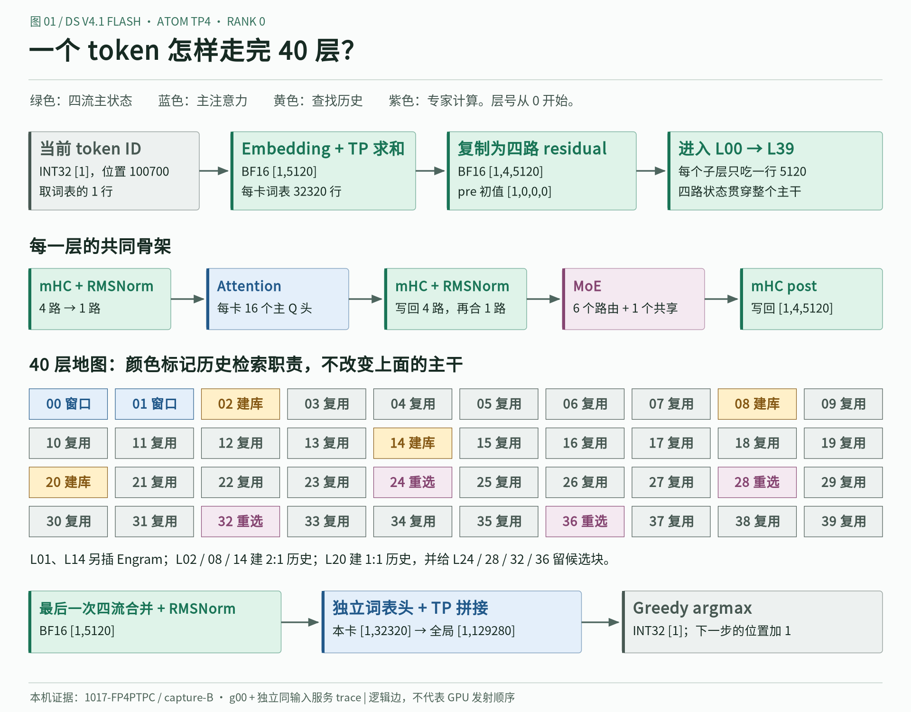
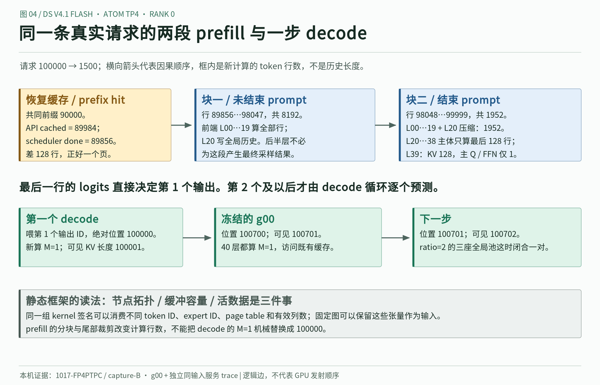
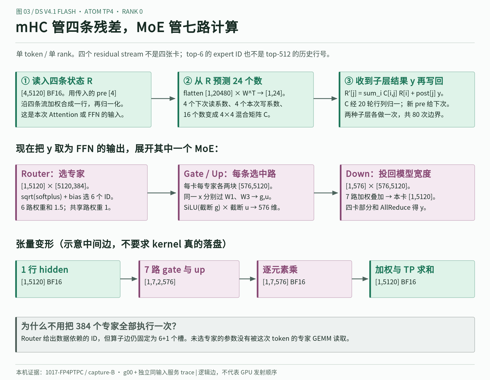
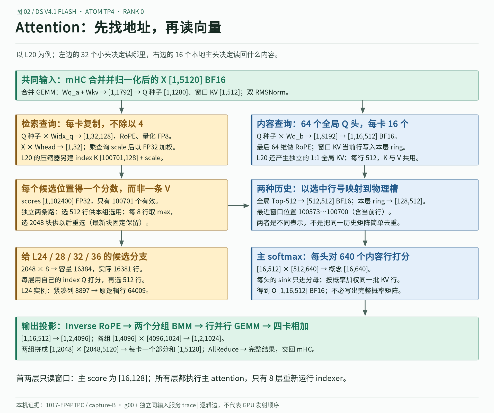
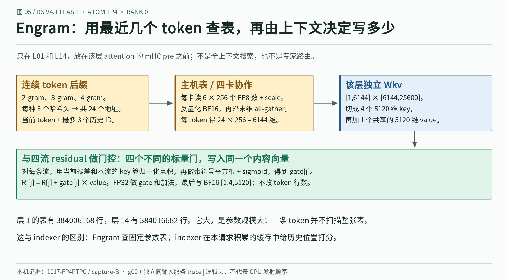

# DeepSeek V4.1 Flash：从一个 token 读懂整张推理图

**可以把 LLM 当静态图看。** 固定的不只是一个 token，还要固定它读到哪一段历史：`下一个 ID, 新状态 = F(当前 ID, 位置, 旧状态; 权重)`。`F` 的节点、形状和本步有效长度可以确定；专家编号、历史行号、页号仍然是张量的**值**，不是临时生成的新算子。这一点和静态图里的 `Gather(data, indices)` 完全一样。

**本机案例**：DeepSeek-V4.1-Flash-1017-FP4PTPC，ATOM `5f6bdb75` / AITER `ad0d5e20`，4 张 MI308X，TP4、EP 关闭、并发 1、纯文本、无 DSpark。冻结 `capture-B` 中第一组完整选择 `g00`：**一个新 token、绝对位置 100700、含当前行的可见长度 100701**。以下未特别说明均为 **rank 0、本轮配置**，层号从 0 起。

**浏览方式**：[五图总览](../../README.md) · [逐节点 shape/dtype 表](operators.tsv)。用 Netron 打开 [decode 全展开图](decode-g00-rank0.onnx)，可从 `L00/attn` 或 `L20/index` 看起；[prefill 分段图](prefill-shapes.onnx) 保留两个整型输入的固定尺寸，但不内嵌原始 ID。两份 ONNX 都是**可浏览的语义结构图，不是可执行模型，也不是直接导出的 HIP Graph**。

## 01　固定输入到底固定了什么

| 证据等级 | 本文用它回答什么 | 不能据此声称什么 |
|---|---|---|
| **实测：输入、调度、抓取张量** | 实际 prompt token IDs、前缀命中、两次 prefill 行数、g00 的 9 份 FP32 scores / INT32 IDs 和选中值。 | 抓取 tap 只保存了 selector 的数据，不知道 g00 当前生成 ID、各层 6 个专家号、所有 hidden 元素或最终 logits 数值。 |
| **实测：原始 profiler** | 相同 prompt/模型的 rank 0 第 25 个中段 decode 标记中，按唯一 HIP launch correlation 归属了 **967** 个 kernel 事件；另有四卡各 32 步统计。 | 不是同一进程/同一 token 的全张量快照。内层 marker 不等于整个引擎步，时间之和不等于下一 token 延迟。 |
| **文件头 + 源码推导** | 实际转换 checkpoint 的 66 个代表性张量头、模型配置、分片与 reshape、mHC 状态、缓存读写和依赖。 | 概念矩阵不一定分配；磁盘 dtype 不是乘法指令，也不必等于输出 dtype。 |
| **教学缩小例** | 用两维向量在纸上算懂 attention、mHC、router、专家。 | 这些示例数值不是抓到的模型激活。 |

**这次固定的是哪条输入？** 原实验核对过同一条 100000-token prompt 与两段实跑切片。公开图保留其实际调度形状 `[1,8192]`、`[1,1952]`，不包含 token 序列。decode 根据捕获的 selector 张量固定到 `g00`；没有记录的值仍作为图输入，不能从 shape 反推。

## 02　先认轴，再认算子

| 记号 | 本例 | 不要和什么混淆 |
|---|---|---|
| B / S / M | B=1；S 是**本次新算**的序列长度；decode S=1，打平 M=B×S=1。变长 batch 通常 M=各序列新行数之和。 | 历史长度 L=100701 **不是**本步 S。 |
| H / C | hidden H=5120；跨子层的残差流 C=4 | C 不是 TP rank，也不是注意力头。 |
| Nq / Nkv / D | 主注意力全局 64 个 Q 头、每卡 16 个；KV 仅 1 个共享头；每头 D=512 | 不要把 KV 头除以 4，也不要套 `D=H/Nq`。这里 `64×512=32768`，通过学习的投影与 H 连接。 |
| Ni / Di | indexer 32 个小 Q 头，每头 128；**每卡复制这套投影** | 它不是主注意力的 16 个本地头。 |
| G / Ro / I | 分组输出全局 G=8，每卡 2 组，每组输出 1024；专家中间宽 I=2304，每卡 576 | 输出低秩 1024 不等于头宽 512；专家的 576 与头数无关。 |
| V / E / K | 词表 V=129280；候选专家 E=384；每 token 选 6 个，再加 1 个常开共享专家 | 稀疏注意力的 K=512 选的是历史行，不是专家。 |

**BSND 对照**：主 Q 全局 `[B,S,Nq,D]=[1,1,64,512]`，每卡 `[1,1,16,512]`，kernel 常见 TND `[1,16,512]`。当前 KV `[1,1,1,512]` 常写成 `[1,512]`；窗口的逻辑 KV 是 `[1,128,1,512]`。mHC 则是 **BSCH** `[1,1,4,5120]`。相同的数字 1 可能是 batch、新 token 或 KV 头，不能只数方括号。图中的 `W` 一律按**文件存储 `[out,in]`**，算式写作 `X @ Wᵀ`；矩阵表中所说的“一行”均指一个 token 的特征。

## 03　从 prompt 到第一个输出

先 prime 一条 100000→1 的请求，再跑这条 100000→1500；两条共享前 90000 个 ID。128-token 页对齐后 API 命中 `floor(90000/128)×128=89984`，所以按 API 只剩 **10016** 个新 ID。但调度日志中请求 2 的 `done=89856`，确实多算一页：`100000−89856=10144=8192+1952`。**命中量、恢复起点、GEMM 的 M 是三个量。**

| 此次执行 | 实际输入 / 位置（含两端） | L00–19 与 L20 压缩 | L20–38 的 decoder 主体 | L39 与词表 |
|---|---|---|---|---|
| Prefill 第一块 | `[1,8192]` INT32；89856…98047 | 8192 行；例如 residual `[8192,4,5120]`，本地主 Q `[8192,16,512]`。L20 建历史。 | 此请求未结束；这里不需要运行 decoder 尾段。 | 不产生可见首 token。 |
| Prefill 最后一块 | `[1,1952]` INT32；98048…99999 | 1952 行；L20 全量更新全局 KV 与 index key。 | 只取最后 **128** 行，即 99872…99999；每卡主 Q `[128,16,512]`。 | L39 的 KV 有 128 行，主 Q、attention、FFN **只需最后 1 行**。`[1,129280]` logits 预测第 1 个输出。 |
| 冻结的 decode | `[1,1]` 逻辑形状，runner `[1]` INT32；位置 100700 | 所有 40 层均算 **1 行**。历史已在 cache 中。 | 此处没有 prefill 的尾段裁剪。 | 已知状态几何，不知道本步输出 ID。温度 0，取最大 logit。 |

这是这个版本启用的 [decoder SWA bounded replay](https://github.com/ROCm/ATOM/blob/5f6bdb75c19a0e4bc57512ef425973d53f0f54f4/atom/models/deepseek_v41/bounded_replay.py)，不是“任何模型都可以把 prefill 裁到 128”。L00–19 是因果前段，不是双向 encoder；L20 建立整段的全局信息，后段复用。尾段窗口从 tail 开始，和“运行所有行再扔掉前面输出”的稠密模型**不严格等价**。每个 prefill 查询只看自己当时可见的行；FP8 indexer 可分带算分，不会要求同时分配 `[8192,102400]` 的常驻 score。服务在最后把少量有效 hidden 行 scatter 到兼容缓冲，接口外观也不代表每行都跑了 40 层。

## 04　Embedding 与 mHC：每层传递的究竟是什么

`embed.weight` 是 BF16 `[129280,5120]`，按词表切成每卡 `[32320,5120]`。对任意有效 ID，拥有对应词表行的 rank 查出一行，其余 rank 贡献零，TP 求和产生同一条 hidden。刚开始把这行复制四份：`R=[r0,r1,r2,r3]`，每条 5120，四条共 **40960 字节** BF16；初始读系数 `a=(1,0,0,0)`。这里的四路都在**一张卡**上。之后四路不必相同。

普通 residual 可以写为 `r′=r+F(norm(r))`。mHC（manifold-constrained hyper-connections）允许保留四份状态，学习“这次读哪几份、结果写回多少、旧流如何互混”。**不是四次调用 F，不是四份独立 attention，也不是缓存检索。** 对一次 attention 或 FFN 子层：

1. **读入**：`x=RMSNorm(BF16(Σᵢ a_in[i]·R[i]))`，输出 `[1,5120]`。RMSNorm 每行除以均方根再乘训练的 γ，不减均值；没有改变宽度。本模型 `rms_norm_eps=1e-20`。
2. **预测系数**：把四行展平 `[1,20480] @ W_hcᵀ[20480,24]`，按整条 flattened residual 的 RMS 缩放。checkpoint `W_hc=[24,20480]`、`base=[24]`、三组 `scale=[3]` 均为 FP32。24 拆成 **4+4+16**：`a_next=sigmoid(…)+1e-6`，`post=2·sigmoid(…)`，`C[4,4]=Sinkhorn(…)`。Sinkhorn 的 20 轮对这个小矩阵交替做行/列归一，使行列和近似 1；不是给 100K 个 token 做 20 次 softmax。`pre` 也不是和为 1 的概率分布。
3. **运行并写回**：`y=F(x)` 只调用一次；`R′[j]=BF16(Σᵢ C[i,j]·R[i]+post[j]·y)`。矩阵第一个轴是旧流，第二个是新流。**本次用的是 `a_in`，本次生成的 `a_next` 给下一子层**。写回可延迟，与下一次 pre/RMSNorm 融合。一个 block 有 attention、FFN 两个这样的边界，40 层共 80 次。

**手算（只为理解）**：缩成两流，`R=[[2,0],[0,2]]`，传入读系数 `[0.75,0.25]`，读出 `[1.5,0.5]`（尚未 RMSNorm）。若子层输出 `[2,1]`，`C=[[.75,.25],[.25,.75]]`，`post=[.5,1]`，写回的新两行是 `[2.5,1]` 与 `[2.5,2.5]`。它们都带着旧信息和本次新信息，但比例不同。

## 05　Attention：先找历史，再读取内容

用 L20 为例。**Indexer 像目录，返回“第几行”；主 attention 才读取这些行的向量。** 主 Q 针对内容做较贵的 512 维点积；索引小头只用 128 维筛选。四张卡拆主 Q 头，不拆同一个头，也不各存四分之一条 KV。

| 次序 / 算子 | rank 0 输入、矩阵和输出（M=1） | 精度与依赖 |
|---|---|---|
| `wq_a + wkv` 合并 | `[1,5120] @ [5120,1792] → [1,1792]`；切 `[1,1280]` Q 种子、`[1,512]` 当前窗口 KV | 两份权重都复制到每卡；本 checkpoint 权重逐输出通道 FP8、激活逐 token FP8，结果 BF16。不是三个完整 Q/K/V 矩阵。 |
| Dual RMSNorm | 分别 norm 1280 维与 512 维。Q 种子输出 FP8 `[1,1280]` + FP32 scale `[1,1]`；KV 为 BF16 `[1,512]` | 这对 Q 数据/scale 可被主 `wq_b` 和 indexer `wq_b` 共用。 |
| 主 `wq_b` / reshape / RoPE | 本卡 `[1,1280] @ [1280,8192] → [1,16,512]`；全局是 `[1,64,512]` | 一次本卡乘法有 `1280×8192=10485760` 个乘加。BF16 Q，最后 64 维按相邻偶奇分量做旋转，448 维不旋转。窗口层使用 θ=10000；有全局路径的层用 θ=160000 与 YaRN。 |
| 本层窗口 KV | 当前 512 维 latent norm/旋转后写 ring；此步读位置 `100573…100700`，长 128 | 本路径 ring 实存 BF16；写窗口时有按 32 维 MXFP8 量化再反量化的数值舍入。Q 不因此变成 FP8 主 attention。每层的窗口 **内容是自己的**。 |
| 压缩器（仅 L02/08/14/20） | ratio=2：复制的 BF16 `Wkv,Wgate` 各 `[512,5120]`，合并输出两行 FP32 `[1,512]`；两 token 沿时间轴逐维 softmax 加权并 norm。ratio=1：仅 `Wkv`，每 token 输出一行。 | 压缩投影**另读 hidden**，不是从本层 SWA ring 简单取偶数行。归一化后为 BF16 latent；一支旋转写主池，另一支供 `indexer.wk`。`g00` 为奇数个可见 token：三处 2:1 保留新半对，已完成行数仍是 50350；L20 的 1:1 新增到 100701。 |
| index key / query / 头权 | key：`[1,512] @ [512,128] → RMSNorm → RoPE → FP8`；index Q：`[1,1280] @ [1280,4096] → [1,32,128]`；头权：`[1,5120] @ [5120,32] → [1,32]` | key 与主 KV 分开存。Q 从 BF16 经 RoPE/量化，F32 头权折入每头 Q scale 与 `1/√(32×128)=1/64`。32 头复制，不是每卡 8 头。 |
| index score / select / lift | 每个候选位置只得一个 FP32 分数：`score[t]=Σₕ w[h]·ReLU(q[h]·k[t])/64`（用反量化逻辑值表示）。按有效列选 512 个 INT32 行号。 | 不做主 softmax。头权可为负，所以真实分数也可为负。紧凑列先还原逻辑行，再经页表映射到物理槽；不是全词表 logits。 |
| 稀疏主 attention | 每个本地头的 Q `[1,512]` 对 512 个选中全局行 + 128 个窗口行，概念 `Q[16,512] @ KVᵀ[512,640] → [16,640]`。加权读 **同一份** KV 行，得 BF16 `[1,16,512]`。 | `Q·K/√512`；每头还有 FP32 `attn_sink`，只往 softmax 分母加 `exp(sink)`，不贡献 V。在线 softmax、分段并合并，并非真的落盘整张概率矩阵。窗口与全局是不同表示，不按时间戳去重。 |
| 逆 RoPE / `wo_a` | `[1,16,512] → [1,2,4096]`；每组 8 个头拼接，各 `[1,4096] @ [4096,1024]` 得 `[1,2,1024]` | 先对输出作 inverse RoPE。`wo_a` 是**各组独立**权重，全局 8 组；本机 gfx942 这一路为 BF16 grouped BMM，别把磁盘的原生 FP8 权重当成这次 BMM 的 dtype。 |
| `wo_b` / TP sum | 两组展平 `[1,2048] @ [2048,5120] → [1,5120]` 部分和；四卡 AllReduce 后仍 `[1,5120]` | 全局 `W[5120,8192]`，每卡取 2048 输入列。四卡相加是为了还原完整点积，不是输出一个 `[1,20480]` 的向量。 |

**RoPE 本身也有 shape**：64 个旋转通道形成 32 对；每套 cos、sin 表各 `[102400,32]`。频率/角度以 FP32 构造，缓存写 BF16；当前绝对位置取一行，kernel 升到 FP32 做成对旋转，再写回 BF16。它改变 Q/K 的方向，不改变 Q/K 的维数。

**主 attention 手算**：取一头，`D=2, q=(√2,0)`；两条共享 KV 为 `u₁=(1,0), u₂=(0,2)`。缩放后 logits 为 `[1,0]`。若 sink=0，分母为 `exp(1)+exp(0)+exp(0)=4.7183`；两行权重约 `0.5761,0.2119`，剩余 `0.2119` 属于无内容的 sink。输出 `0.5761·(1,0)+0.2119·(0,2)≈(0.5761,0.4239)`。实际是每卡 16 头分别做这件事，D=512，不是把所有头混成一个 softmax。

## 06　四十层为什么只打八次索引分

下面是完整层映射，而非“以第一层代全模型”。每一行都另有本层主 attention、MoE 和 mHC；表中的复用**只指长期 KV、索引键或选择结果，不是复用上一层 hidden、主 Q 或 attention 输出**。

| 层（含两端） | 长期池的建库层 / 比率 | 供本组使用的 Top-512 来自 | 这组特有的事 |
|---|---|---|---|
| L00–01 | 无 / 0 | 无 | 两层都只读自己的 128 窗口；L01 有 Engram。 |
| L02–07 | L02 / 2 | L02 全池选 | L02 建主池与 index key；L03–07 只消费。 |
| L08–13 | L08 / 2 | L08 全池选 | 新的一座池，不是继续用 L02。 |
| L14–19 | L14 / 2 | L14 全池选 | L14 先做自己的 Engram，再建池。 |
| L20–23 | L20 / 1 | L20 全池选 | L20 **还**从同一全长 score 独立选候选块，不是从已选的 512 行里再选 2048 块。 |
| L24–27 | L20 / 1 | L24 紧凑重选 | 读 L20 的块名单，用 L24 自己的 index Q 与头权。 |
| L28–31 | L20 / 1 | L28 紧凑重选 | 块名单共用，不代表所选 512 行共用。 |
| L32–35 | L20 / 1 | L32 紧凑重选 | 后三层复用 L32 的结果。 |
| L36–39 | L20 / 1 | L36 紧凑重选 | 后三层复用 L36 的结果；L39 仍有真正的 attention 和 MoE。 |

**实测的 `g00`，不是容量估算**：

| selector 的输入 | 发起层 | 实分配 / 有效列（每行为 FP32） | 输出与真实值 |
|---|---|---|---|
| 2:1 全池 score | 02、08、14 | `[1,51200]` / `50350=floor(100701/2)` | 每层 `[1,512]` INT32。L02 列 317 分数 −0.937070；L08 列 52 为 +0.529879。 |
| 1:1 全池 score | 20 | `[1,102400]` / 100701 | 选 512 行；列 3 为 +4.102393，列 100700 为 +2.589838。有效的最近位置也可以被选。 |
| 每 8 行取 max 的块 score | 20 | `[1,12800]` / `ceil(100701/8)=12588` | `[1,2048]` 块号。最后一个块 ID 12587 被置 `+Inf` 以保证保留；这是刻意的哨兵，不是 GEMM 溢出。 |
| 紧凑列 score | 24、28、32、36 | `[1,16384]` / `2047×8+5=16381` | 各选 512，再 lift。L24 紧凑列 8897 → 原始行 **64009**，分数 −2.208697；L28 列 12103 → 行 85639。 |

为什么是 5？`100701=12587×8+5`；最后块只有 5 个活位置。比如 L24 的 8897：`8897//8=1112` 为候选表中的块序号，余 1；对应原始块是 8001，所以 `8001×8+1=64009`。再把逻辑行除以这个池每页行数找 page，再取页内偏移，才能拿真实 KV。**请求页**为 128 token，2:1 池每页 64 行，1:1 池每页 128 行；**选块的 8** 不是请求页大小。选完的行按逻辑列排，不是按分数降序。

所以是 **8 次打分、9 次选择、40 次主 attention**。假如你把 `100701` 当成每头主 attention 的列数，会高估很多：本步单个非窗口层主 score 的逻辑规模是每卡 `16×640=10240` 个数，而不是 `16×100701`。扫描较长历史的是另一条 128 维 indexer；窗口层则只有 `16×128`。

## 07　MoE：选谁，算什么，怎样加回来

每层都是 MoE FFN，没有“前几层改用普通 dense FFN”的例外。一个**专家**是有自己 W1、W3、W2 的小前馈网络；**路由器**是另一个小线性层。Attention 决定**去哪里取信息**，MoE 决定**用哪几套权重处理当前 token**。二者之间还隔着 mHC 写回、合并与 RMSNorm。

| 步骤 | 全局逻辑 / 每卡实际宽度 | dtype 与算术 |
|---|---|---|
| router gate | `[1,5120] @ Wᵀ[5120,384] → [1,384]`，所有卡同一份 | W、传给 topk 的 logits 为 BF16（trace 的 `topk_gating_kernel_opt<hip_bfloat16,float,384,…>`）；文本选择 bias `[384]` FP32。图像 bias 不走。 |
| 选 6 + 加共享槽 | `s=sqrt(softplus(logits))`；从 `s+bias` 取前 6；`αᵢ=1.5·sᵢ/(Σ选中 s+ε)` | 选中的 **ID 为 INT32，权重 FP32**。用原始 s 归一，**不带选择偏置，也不再 softmax**。共享专家常开，权重 1，fold 到槽 384：逻辑 `[1,6] → [1,7]`。 |
| Gate 与 Up：两条并行 GEMM | 每个选中专家全局 W1 与 W3 各 `[2304,5120]`；每卡各 `[576,5120]`。合并投影是 `[1152,5120]`，不是先 gate 再把它喂给 up。 | `g=x@W1ᵀ, u=x@W3ᵀ`。截断：`g=min(g,10)` **只有上限**，`u=clip(u,−10,10)`；`a=SiLU(g) ⊙ u`，其中 `SiLU(g)=g·sigmoid(g)`。七路的本地 stage-1 激活为 BF16 `[1,7,576]`。 |
| Down 与合并 | 每专家全局 W2 `[5120,2304]`，每卡 `[5120,576]`；每路把 `[1,576]` 投回 `[1,5120]` | 在本次 batch-1 FlyDSL 路径，路由系数送入 Down，对七路结果加权求和，写 BF16 `[1,5120]`。stage-1 BF16 舍入是有意义的，不要自由交换权重乘法和舍入。 |
| TP 通信 | 四卡各得到一个 `[1,5120]` 部分和，AllReduce sum 后 `[1,5120]` | `enable_expert_parallel=False`：**不是每卡只放 96 个完整专家，不是 all-to-all 派发 token**。每卡有这些专家的 I 维分片，算同一组被选 expert 的各自部分。 |

在本例一张卡上，七路中每路三个投影共 `3×5120×576` 个乘加，合计 **61931520 MAC**（不含 router、激活和通信）。这是逻辑工作量，不是七次或二十一次 GPU launch：实测每层专家主体只有一发 GateUp、一发 Down。不同 token 可以选完全不同的六个 ID 而不改变这个 batch-1 接口形状。

**手算一：为什么选择偏置不能混进权重。** 缩成 3 选 2。若激活后的 `s=[.2,.5,.6]`，选择 bias `[.6,0,0]`，排序看 `[.8,.5,.6]`，选专家 0 和 2。真正加权用 `[.2,.6]`，得到 `[.375,1.125]`，而非按 `[.8,.6]` 加权。共享专家另加 1。真实 384 选 6 是同一个逻辑。

**手算二：gate/up 不是路由。** 取一个专家，`x=[1,2]`，`W1=[[1,0],[0,1]]`，`W3=[[1,1],[1,0]]`。则 `g=[1,2]`，`u=[3,1]`。无须截断时，`SiLU(g)⊙u≈[0.7311×3,1.7616×1]=[2.1932,1.7616]`。若 `W2` 是单位阵，这就是该专家未加权的输出。即使路由已经选中它，**每个特征仍被自己的 gate 调节**。

## 08　Engram：参数表，不是 KV cache

只在 **L01、L14**。每层有独立大表，分别 `[384006168,256]` 与 `[384016682,256]` FP8，另有 E8M0 scales `[行数,8]`。当前原始 token 先经词表重映射得 `[1]` INT32，配合已提交历史 `[1,3]` INT64 的压缩 ID，构造 **2/3/4-gram × 每种 8 头 = 24 个地址**，逻辑查表行号 `[1,24]` INT64。这不是把 3.84 亿行与当前 token 做 attention，而是按整数地址读 24 行。缺少前文时用模型约定的 padding。

本次日志显示 UVA 查锁页主机内存，四卡各查 6 头：`[1,6,256] → [1,1536] BF16`；all-gather 得 `[1,6144]`。复制的 `Wkv[25600,6144]` 投影成四个 `[1,5120]` key 加一个共享 `[1,5120]` value。每条流与自己的 key 算带可学习权重的归一化点积 `d`（除以 √5120），`gate=sigmoid(copysign(sqrt(max(abs(d),1e−6)),d))`；更新 `R[j]←R[j]+gate[j]·value`。归一化、门和加法用 FP32，写回 BF16。因为这里要读**已经写回的四流**，前一子层的延迟 post 必须先结清。

## 09　权重、计算、缓存：三份不同的 dtype 表

PTPC 在这里是 **per-token 激活 / per-channel 权重**。不能凭模型顶层 `dtype=bfloat16` 断言全图 BF16，也不能凭 `FP4PTPC` 断言全部在线是 FP4。下面的磁盘尺寸和 dtype 来自这次运行所用转换版 checkpoint 的 safetensors 文件头；运行算术则另据实际后端和 trace 核对。

| 代表张量 / 状态 | 文件头或持久存储 | 本次运行中如何使用 |
|---|---|---|
| `embed.weight` / `head.weight` | 两个不同的 BF16 `[129280,5120]`，不绑权 | 输入查表，输出做 BF16 GEMM。词表按 TP 切，两端通信不同：输入求和，输出拼接。 |
| `wq_a,wkv,wq_b,wo_b`；indexer `wq_b`；Engram `wkv`；共享专家 | 例 `wq_b` FP8 E4M3 `[32768,1280]` + F32 scale `[32768,1]` | 离线转换的 PTPC 投影。权重的 scale 每个输出通道一个；普通 dense 输入动态量化，如 `[1,5120]` 配一个 token scale；对外结果通常 BF16。共享专家折入 BS1 专家后随该 kernel 的算术。 |
| `wo_a` | 原生 FP8 `[8192,4096]` + E8M0 `[256,128]`，每个 32×32 块一个 scale | 此 gfx942 路径加载为 BF16，inverse RoPE + 分组 BMM，再喂 PTPC `wo_b`。不是把全部 dense 都展开 BF16。 |
| routed `experts.0.w1/w3`、`w2` | `w1/w3` **I8 容器** `[2304,2560]` + E8M0 `[2304,160]`；`w2` I8 `[5120,1152]` + E8M0 `[5120,72]` | 每字节两个 E2M1 FP4，K 每 32 个数一个 scale。显式 `*.ffn.experts* → ptpc_fp8` **加载时**转换，40 层记录为 `torch.float8_e4m3fnuz`。本 BS1 入口是 BF16 hidden、FP8 权重/逐通道尺度、BF16 stage-1 与输出；不等于对每个 token 重转全部专家。 |
| mHC / router / norm | mHC `fn/base/scale` FP32；router W BF16、bias FP32；RMSNorm γ BF16；attention sink FP32 `[64]`，每卡 16 | 四流及子层输出 BF16，门值与 4×4 混合 FP32；注意力归一的归约使用 FP32。外部边精度和每条硬件指令不可混为一谈。 |
| 主 KV / SWA / index K | 主池和窗口每逻辑行 `512×2=1024 B` BF16；index K 每行 128 个 FP8 + 一个 FP32 scale，相当于 132 B（物理 preshuffle）。 | 索引 scale 取 2 的幂，读取形式是 FP32；不要和磁盘 1 字节 E8M0 scale 数组混淆。当前窗口会模拟 MXFP8 舍入；全局压缩主池走 BF16 写。页表、选择行、专家 ID 均是整数，不是量化激活。 |

**只算活数据，不是假装测了显存**：四座长期池这一步共有 `3×50350+100701=251751` 个主行，每卡纯 BF16 内容 `257793024 B`；40 个窗口的 128 个**可见**行再有 `40×128×1024=5242880 B`。不含页预留、ring 容量、对齐、索引池、scale、压缩器状态、多个请求及 workspace，不能据此报服务实际显存。反过来，一行全长 index scores 自己就有 `102400×4=409600 B`，它也不是 KV。

**不同配置不要混读**：原始 1017 的相关 dense 权重是原生 32×32 FP8 块；转换清单是 290 个投影转成 PTPC、67 个 FP8 张量保留，并未离线把 routed FP4 改光。native-FP8 dense、A16W4、FP8 主 KV/FP4 index 等其他配置可能保留相同的几何，但改变存储、乘法和 kernel。本图只覆盖本文固定的 ATOM 配置。

## 10　从 L39 到输出，再打开 trace 对照

另见独立子页：[rank 0 的 24 步 Decode kernel 清单，以及 Triton/HIP mHC 单卡对照](decode-kernels-mhc.md)。该子页用另一份 100K→24 诊断 trace 和它自己的无 profiler C1 基线；不要与本节的 32 步平均混用。

L39 的 FFN 写回后，用它生成的最后一组 `pre` 合成单行，RMSNorm，再乘**独立**词表头：本卡 `[1,5120] @ [5120,32320] → [1,32320] BF16`，TP all-gather 拼成 `[1,129280]`。`temperature=0, top_p=1, ignore_eos=true`；greedy 只要 argmax，没必要先写出 softmax 概率。输出 INT32 ID 用于下一步，位置加 1。**这条 V4.1 路径不是再跑另一套 V4 `hc_head`，也没有启用视觉 encoder 或三个 draft 层。**

| 你想在图上找什么 | rank 0 每个 decode 的 kernel 锚点 | 同输入 profiler：每步/四卡的单卡均值 |
|---|---|---|
| mHC 两次/层 | `mhc_fused_post_pre_delayed_rmsnorm_*`：main 80（3 无前 post，77 有），reduce 80 | main+reduce **1.494 ms**；不含独立的 post/collapse。 |
| 目录打分、选历史 | `gluon_deepgemm_fp8_paged_mqa_logits_preshuffle` 8；radix 4、短 512 选择 4、块 2048 选择 1 | 打分 **0.046 ms**；选择 **0.361 ms**。不含投影/地址辅助，不是整个 indexer。 |
| 主 attention | 两源窗口 kernel 2；稀疏 split 38 + combine 38 | **0.703 ms**；不含全部投影、norm、cache 写。 |
| Router 与专家 | `topk_gating_kernel_opt` 40；`moe_2stage_gateup_batch1` 40、`moe_2stage_down_batch1` 40 | 选择专家 **0.317 ms**；两发专家主体合计 **1.157 ms**。前者不是 router 的全部 GEMM。 |
| 通信 / Engram / 采样 | 单个关联样本见 BF16 Lamport AllReduce **81**（对应 embedding 1 + attention 40 + FFN 40）、UVA lookup 2、all-gather 3；整个外层 trace 可见 argmax 的两段 fold。 | 通信包括等待；内层 decode marker 不含所有 postprocess。不要把未归入分类的 kernel 当成不存在。 |

时间表来自相同 prompt 的独立服务 profiler：选 `decode[bs=1 tok=1 d=1]`，每个 rank 取 32 个中段完整标记，再对单卡时长取均值；不是单个 `g00` 的时间。**847 个教学图节点 ≠ 967 次可归属 kernel ≠ 客户端 TPOT**。融合、并行流、集合通信等待和外层采样分别解释了为什么这些数没有一一对应关系。此分支不附原始 profiler 文件。

## 11　把整台模型放回一张脑图

可以从 L24 自己走一遍：一条 BF16 四流状态进来，**mHC** 用上一次的系数组成一个 5120 维问题。**Indexer** 用 32 个小头，只在 L20 留下的 16381 个有效候选中挑 512 行；它不返回答案，只返回地址。**主 attention** 用本卡 16 个大头，从这些行和本层最近 128 行中读出内容，再用 `wo_a/wo_b` 和 TP 求和还原 5120 维。mHC 把答案写回四条流，再读一行给 FFN。**Router** 看这行，给 384 名候选打分、叫来 6 个专家，另有 1 个共享专家一直工作；**Gate/Up** 在每位专家内逐维筛特征，**Down** 把特征投回并加权叠加。mHC 把这次改动记回状态。L25 可以复用 L24 选出的地址，但它仍用自己的主 Q、窗口、专家和 mHC 来回答问题。

沿时间看，则是另一张简单的图：**prefill 是成批建状态；decode 是带状态的单步函数；生成是反复调用这个函数**。整套模型可以这样记分工：**KV 存本请求的内容，indexer 找内容，attention 读内容，MoE 变换内容，mHC 负责把前后两次更新接起来，Engram 偶尔补一份从训练参数表里查到的短语记忆。** 最后词表头才把内部向量翻译成“下一个 token 是谁”。

## 12　复核入口

| 查什么 | 分支内资料或固定版本的公开源码 |
|---|---|
| 形状与依赖 | [847 个语义节点及张量表](operators.tsv) · [Decode 全图](decode-g00-rank0.onnx) · [Prefill 分段图](prefill-shapes.onnx) |
| 40 层的主干与复用 | [V4.1 层拓扑](https://github.com/ROCm/ATOM/blob/5f6bdb75c19a0e4bc57512ef425973d53f0f54f4/atom/models/deepseek_v41/config.py) · [模型主循环](https://github.com/ROCm/ATOM/blob/5f6bdb75c19a0e4bc57512ef425973d53f0f54f4/atom/models/deepseek_v41/model.py) |
| Attention 与压缩器 | [查询、索引、两源读取与输出投影](https://github.com/ROCm/ATOM/blob/5f6bdb75c19a0e4bc57512ef425973d53f0f54f4/atom/models/deepseek_v41/attention.py) · [1:1 / 2:1 压缩](https://github.com/ROCm/ATOM/blob/5f6bdb75c19a0e4bc57512ef425973d53f0f54f4/atom/model_ops/deepseek_v41/compressor.py) |
| mHC / Engram / MoE | [延迟 pre 与四流写回](https://github.com/ROCm/ATOM/blob/5f6bdb75c19a0e4bc57512ef425973d53f0f54f4/atom/model_ops/deepseek_v41/mhc.py) · [Engram 门控](https://github.com/ROCm/ATOM/blob/5f6bdb75c19a0e4bc57512ef425973d53f0f54f4/atom/model_ops/engram/device/gate.py) · [V4.1 专家路由](https://github.com/ROCm/ATOM/blob/5f6bdb75c19a0e4bc57512ef425973d53f0f54f4/atom/models/deepseek_v41/moe.py) |

本报告沿用 [MI308X 算子报告分支](https://github.com/TianHao65/ATOM/tree/dsv41-gfx942-ballot-topk-report) 的浏览方式：根 README 看图，`operators/` 读分项资料。本文的图、shape/dtype 和样本均来自本次图册，不是该参考报告的测量结果。