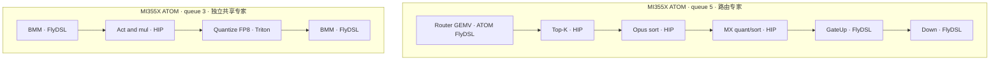

# 同样跑 ATOM：MI308X 与 MI355X 的 TP4 kernel 对照

[三套运行总览（含 vLLM）](mi308x-mi355x-traces.md) · [gfx942 逐项账本和 HIP 单测](decode-kernels-mhc.md) · [两套 ATOM 的完整符号表](trace-compare/atom-pair/symbols.tsv) · [第 10 步逐发射顺序](trace-compare/atom-pair/step10-order.tsv)

**实测：gfx942 ATOM 每个外层 decode forward 有 974 次 GPU kernel 调用，gfx950 ATOM 有 1159 次，多 185 次。** 旧报告的 967 也正确，但它是**内层**模型标记，不含全部准备和采样。gfx950 这次不是简单把整个模型从 Triton 换成 HIP：**mHC 换成原生 HIP，索引打分从 FP8 Gluon 换到 FP4 FlyDSL，主 sparse attention 从 Triton 换到 Opus/HIP，专家 GEMM 仍是 FlyDSL，但专家格式和共享专家路径变了。**

### 1. 先对齐模型与时间口径

| 实际记录 | MI308X / gfx942 | MI355X / gfx950 |
|---|---|---|
| 服务 | ATOM `5f6bdb75`、AITER `ad0d5e20`、TP4/DP1/C1、base，无推测解码；每卡 80 CU | ATOM `d6681e153`、`amd-aiter 0.1.0`（包中无 AITER git SHA），Torch `2.13.0+rocm10.0.0`，gfx950 / 256 CU，TP4/DP1/C1、FULL 单序列 graph、无推测解码 |
| 权重与缓存 | `1017-FP4PTPC`，显式在线转换 routed→per-channel FP8；共享专家折入；BF16 主 KV、FP8 index；页 128 | 包内模型为 DeepSeek V4.1 Flash，服务挂载为 `/model`，没给出同 revision 证明。native 32×32 FP8 dense 路径、FP4 路由与单独 FP8 共享专家；`online_quant_config=None`。BF16 主 KV、**FP4 index**、页 **16** |
| Profile 工作量 | 100000→24，命中 89984，调度从 89856 恢复。2 次 prefill：8192、1952；bounded decoder replay 开。取全部 24 个 BS1/S=1 decode 标记 | 从 `mi355x-atom-dsv41-flash-tp4-100k-1500-trace-20261126.zip` 读取四份 rocprofv3/Perfetto。100000→1500，greedy、ignore EOS；prefix cache 开，但 warmup 的 prompt 从第 1 个 ID 就不同；实算 `12×8192+1664+32=100000`。两种 SWA bounded replay 均关。**14 次 prefill、1500 次单行 decode 标记** |
| 无 profiler 的时间 | 另跑 100K→1500，4 请求中位 **TTFT 627.613 ms / TPOT 7.490 ms / 请求 E2E 11.886 s** | 只有另一条未录制 warmup：100K→**4**，TTFT 13.4167 s、TPOT **7.3 ms**、服务 latency 13.4386 s。仅 3 个首 token 后间隔，且非同一 prompt；**没有无 profiler 的 100K→1500 稳态基线** |
| 开 profiler 的时间 | 见下方设备统计；不能用其设备和代替 7.490 ms | 100K→1500 的服务 `usage`：TTFT **2.3242 s**、TPOT **12.7 ms**、latency **21.313 s**；HTTP 客户端耗时 **21.320 s**。这些是整次开启 rocprof 的数，不是无采样 C1 |

这里比较的是**两套 ATOM 各自实际派发了什么**，不是同权重、同输入值、同 cache、同版本、同 profiler 的换卡实验。TPS/TPOT、单卡设备时长之和、首末设备事件跨度是三种不同的量；尤其不能用 `12.7 / 7.490` 或 `7.3 / 7.490` 当作芯片速度比。

### 2. 为什么是 1159，不是把时间线切开再除以 1500？

| rank 0 边界 | 事件总数 / forward 数 | kernel/步 | 不同设备符号 | GPU duration 和，ms/步 |
|---|---:|---:|---:|---:|
| gfx942：内层 `decode[bs=1 tok=1 d=1]` | 23208 / 24 | **967** | 53 | **8.349122** |
| gfx942：外层 `ATOM::forward tokens=1 prefill=0 decode=1` | 23376 / 24 | **974** | 59 | **8.391870** |
| gfx950：`ATOM::decode rank=0 tokens=1` 的 ROCTx correlation | 1738500 / 1500 | **1159** | 64 | **11.525335** |

前两行取同线程的唯一 HIP launch correlation；最后一行用 `marker_api` 与 `kernel_dispatch` 的 **`debug.corr_id`** 精确 join。每 rank 的 **1,758,248** 个 dispatch 全部且仅归入一个 forward：**19,748 prefill + 1,738,500 decode**。每个 decode 都是 1159 次、64 个符号。四卡共 6,000 个 decode 标记，但它们是**同一个请求**的四个 worker，不是 6,000 个独立输出 token。两套外层范围都看到准备、词表、argmax 两段和 RCCL；这比内层对外层更接近，但仍非同一种插桩。

**为什么不用 capture 清单里的 `from_first_decode_marker`？** rank 0 该数为 **1,740,355**。按关联 ID 追溯，其中 **1,855 次属于此前的 prefill**，因为 host 已进入 decode 时设备队列仍在做旧工作。其余三卡各有 1856 次同类事件。Perfetto 中所有 flow 的两端 ID 一致，1514 个 forward 均有可核对的 flow 起点。每个文件独立的 `memory_copy` 轨有 25 条，不计为 kernel；设备符号 `__amd_rocclr_copyBuffer` 在 `kernel_dispatch` 轨则计入。

**查单个 kernel 时请看 rocprof 的 `debug.delta_ns`，不要用可视化的 `slice.dur`。** 对四卡逐事件验证了 `delta_ns = end_ns − begin_ns`；实际设备时长全部为正。多个 queue 共享显示 track；rank 0 有 **296235** 个 dispatch 的显示时长与生产者时长不一致，在 rank 0 的 decode 总和却恰好相等。例：`v41_router_s1` 按显示切片为 1.055531 ms/步，按设备时间是 **0.495022 ms/步**。四卡显示为零的 52/98/28/11 条均非零设备时间，全部保留。本文的 MI355X 分项、窗口和顺序 TSV 的 duration **一律取设备字段**。包内校验未报告 data loss；独立导入每卡有一次 track descriptor 重复预留告警，切片数与包内凭据一致。

### 3. 哪些具体算子换了？

每格是**调用数 / GPU ms，每个 decode forward，rank 0**；gfx942 取外层 24 步均值，gfx950 取 1500 步均值。列出的家族是有相应证据的计算，不将不同边界强算成一一对应的投影。

| 功能 | MI308X ATOM | MI355X ATOM | 应如何读 |
|---|---|---|---|
| mHC 主体 | Triton `main` **80 / 0.679** + `reduce` **80 / 0.801** | AITER 原生 HIP `mega_mhc_kernel` **80 / 0.725** | 160 发→80 发，观测差 **0.756 ms/步**；两边都另有 **3** 发 `mhc_post`（0.012736 / 0.012497 ms）。这不是同卡换后端所得收益 |
| Dense 投影 | 通用 `kernel_gemm_0` **130 / 0.908**，Tensile 风格 `Cijk_*` **85 / 1.045** | `bmm_a8w8_mxscale_*` **250 / 1.348**（AITER FlyDSL）；另有 BF16 FlyDSL hgemm 2 发、预编译 BF16 `.co` 3 发 | native blockscale 导致 A8W8 BMM 广泛出现，含共享专家和分组投影；不能把每个同名 GEMM 单独指认为某层的 `wq_b` |
| 激活、Q/K 与输出 | 动态 per-token 量化 **82 / 0.389**，Q/K fused RMS+quant **40 / 0.190**，inverse RoPE **40 / 0.200** | ATOM Triton `quantize_fp8_kernel` **122 / 0.476**，AITER Triton dual RMSNorm MXFP8 **40 / 0.175**，HIP `inverse_rope_group_quant` **40 / 0.183** | 都有 40 次 `_rope_window_kernel`；量化粒度、是否与逆 RoPE 融合不同 |
| Indexer 打分 | `_gluon_deepgemm_fp8_paged_mqa_logits_preshuffle` **8 / 0.046**，AITER **Gluon** | `pa_mqa_logits_fp4_rowgroup_kernel_0` **8 / 0.039**，AITER **FlyDSL**；另有 Q 的 `rope_hadamard_rotate_activation_fp4quant` **8 / 0.038** | 长期主 KV 两边均 BF16；**index cache FP8 vs FP4**。不能只比较 0.046/0.039 就说总 indexer 提速 |
| Indexer 选择 | 4 发原生 radix + 4 compact-512 + 1 block-2048；**9 / 0.390** | 4 发 FlyDSL `radix_topk_one_block_decode_mixed…packed` + 4 发 compact-512 + 1 发 packed block-2048；**9 / 0.213** | 仍是 4+4+1。长行本身 **0.266→0.108 ms**；选择之外的块最大值、列还原未并入 |
| 主 sparse attention | ATOM Triton 2 发未 split + 38 次 partial + 38 次 combine，**78 / 0.706** | AITER 原生 **Opus** `opus_mla_v4_prefill_a16w16_…` **40 / 0.447** + `pa_decode_ps_reduce_hip_kernel` **40 / 0.197**，**80 / 0.644** | **名字含 prefill 的主 kernel 真的出现在每个 decode**。阶段是 marker 决定的，不是文件或函数名决定的 |
| MoE router | BF16 投影后 `topk_gating_kernel_opt` **40 / 0.312**；投影不含在这个数里 | ATOM **FlyDSL** `atom::v41_router_s1` GEMV **40 / 0.495**，再接原生 HIP `topk_gating_kernel_opt` **40 / 0.285** | GEMV 算 logits、Top-K 才选专家；即使符号是 C++ mangled，也不能把前者误标 HIP |
| routed Gate/Up、Down | `moe_2stage_gateup_batch1_0` **40 / 0.741**、`…down_batch1_0` **40 / 0.413**，合 **1.154 ms**；包含 folded shared 槽 | `mfma_moe1_silu_mul_afp8_wfp4_fp8_…` **40 / 0.419**、`gemm2_a4w4_port_…` **40 / 0.189**，合 **0.608 ms** | 两边均 AITER **FlyDSL**。950 另有排序 **40 / 0.410**、MX quant/sort **40 / 0.177**，FP8 共享专家单独算，结果再相加。**0.546 ms 不是整个 MoE 的等价节省** |
| TP 通信 | `lamportAllReduceWaveSplit` **81 / 0.708**；all-gather **3 / 0.117** | `ar_ll_gfx9` **81 / 4.220**；all-gather **3 / 0.592** | 两边均为 AITER 原生 HIP；外层另各有 1 发 RCCL。发射次数相同，时长含等待，不能把差额直接归因为链路或某个 rank 的瓶颈 |

**mHC 的三种真实特化。** `H=5120, VARIANT=1`；按设备模板参数 `MXFP8, HAS_POST`：`false,true` **40 次 / 0.355323 ms**（FFN）；`true,true` **37 / 0.343742**、`true,false` **3 / 0.025686**（attention 有/无待应用 post）。该版本源码在 attention 路径请求额外 MXFP8 输出，FFN 保留 BF16。合计 **0.724751 ms**，不是在 gfx942 上测过的 generic `VARIANT=13`。gfx942 同卡 A/B 里通用 HIP 反而慢，见[单测子页](decode-kernels-mhc.md)。

### 4. 净多的 185 次怎么对账？

下表采用同一对**外层**边界，逐行互斥。Gluon、FlyDSL、Triton 是不同实现口径；原生 Opus 设备模板归 HIP；AITER 是提供方而不是语言。与当前实验对应的生成器/设备源码作为归属依据，AITER 没有记录构建 git SHA，不能用相邻 checkout 证明两个二进制逐字节一致。

| 实现归属 | gfx942 次/步 | gfx950 次/步 | 950 − 942 |
|---|---:|---:|---:|
| AITER 原生 HIP（含 Opus） | 290 | 468 | +178 |
| AITER FlyDSL | 87 | 351 | +264 |
| AITER Triton | 160 | 40 | −120 |
| AITER Gluon | 8 | 0 | −8 |
| ATOM Triton | 206 | 204 | −2 |
| ATOM FlyDSL | 0 | 40 | +40 |
| AITER 预编译 `.co`（不猜源码语言） | 0 | 3 | +3 |
| ROCm BLAS / Tensile 风格 | 85 | 0 | −85 |
| PyTorch/ATen | 4 | 44 | +40 |
| ROCm runtime copy kernel | 3 | 8 | +5 |
| RCCL | 1 | 1 | 0 |
| 未逐发确认实现的 `kernel_gemm_0` | 130 | 0 | −130 |
| **合计** | **974** | **1159** | **+185** |

其中 gfx950 的 351 次 AITER FlyDSL 可复核为 **250** 次 MXscale BMM + **80** 次 routed 专家 GEMM + **8** 次 FP4 算分 + **9** 次 selector + **2** 次 BF16 hgemm + **2** 次词表 argmax。这里的 0 表示“本次 decode 没有对应设备符号”，不是芯片不支持这个后端。

### 5. 前后 kernel：要看 queue，不能只看 stream 名

**gfx942，第 10 步，Kineto stream 3**：`router Top-K → GateUp → Down → Lamport all-reduce` 连续出现 40 次，另一个 stream 有 Engram 相关工作。**gfx950，rocprof 的 stream 0 实际包含三个 HSA queue**：第 10 步 queue 5 有 950 发、queue 3 有 204 发、queue 7 有 4 发；stream 10 / queue 1 另有 1 发 copy。若按 stream 0 的启动时间排序，可能把共享专家的某个 BMM 插在 routed GateUp/Down 中间。**按同一物理 queue 重新检查**，下图前两条专家链在第 10 步均各出现 40 次。

| 位置 | gfx942 ATOM 观察到的相邻序列 | gfx950 ATOM 观察到的相邻序列 |
|---|---|---|
| mHC → attention 输入 | `Lamport sum → Triton main → Triton reduce` | queue 5：`HIP Mega-mHC → MXscale BMM → dual RMSNorm MXFP8`；后续再过本卡 Q 的 BMM |
| 主 attention 输出 | `Triton partial → combine → inverse RoPE` | queue 5：`Opus main → HIP reduce → inverse RoPE+group quant`，第 10 步 40 次，之后进入输出 BMM |
| 历史检索 | `per-group quant → scale indexer weights → Gluon FP8 logits → 原生 radix`（一个 full 层例） | queue 5：`rotate/FP4 quant → FlyDSL FP4 logits → FlyDSL radix`（full 层例）；另有紧凑和块级候选分支 |
| 专家主体 | `router → GateUp → Down → Lamport sum` | queue 5：`quant/sort → GateUp → Down` 的三连在 1500 步共 **60,000 次**。同一时间段 queue 3 可跑 shared；把两条链混成一条会误判融合边界 |
| 最后怎么采样 | 词表投影 → all-gather → argmax fold0/fold1 → RCCL（外层可见） | 主 queue 同样能看到 all-gather → argmax fold0/fold1 → RCCL；copy 还有独立 queue |

这些是**设备的观测顺序**，不是已证明的数据依赖或 CUDA/HIP graph 拓扑。rocprof 这份 pftrace 不含逐发 HIP API 区间，不把 1159 发都说成“同一个 `hipGraphLaunch` 内部”。可下载 [逐步顺序](trace-compare/atom-pair/step10-order.tsv)、[同 HSA queue 的前后邻居](trace-compare/atom-pair/mi355x-queue-neighbors.tsv) 和 [同 stream 的前后邻居](trace-compare/atom-pair/neighbors.tsv)；符号 ID 均在[同引擎符号表](trace-compare/atom-pair/symbols.tsv)中。

### 6. 为什么看起来几个核心都快，整步 duration 和却更大？

**rank 0 的设备账本**：把 81 次 sum、3 次 all-gather、1 次 RCCL 放入「已识别通信」，gfx942 为 **0.838 ms**，gfx950 为 **4.821 ms**；其余设备时长和分别 **7.554、6.704 ms**。通信多约 **3.983 ms**，其余少约 **0.850 ms**，净差 **+3.133 ms**，对上外层的 **8.392→11.525 ms**。这是**账务分解，不是消除通信就能省这些 ms**。collective 可能等待其他 rank，profiler 也会扰动相对到达时间；没有隔离单项的服务 A/B，无法给链路带宽或 profiler 单因素定责。

| MI355X ATOM，rank 0 | 起始 decode 1–24 | 中段 739–762 | 末段 1477–1500 | 全部 1500 |
|---|---:|---:|---:|---:|
| 每步调用数 | 1159 | 1159 | 1159 | 1159 |
| 设备时长和（ms/步） | **8.539** | **9.773** | **13.090** | **11.525** |
| 其中 `ar_ll_gfx9` / all-gather（ms/步） | 1.772 / 0.064 | 2.929 / 0.132 | 5.096 / 1.230 | 4.220 / 0.592 |
| mHC 主体 + 独立 post（ms/步） | 0.738 | 0.736 | 0.737 | 0.737 |

因此用同样靠近 100K 的**头 24 步**复核，rank 0 外层 GPU 和是 **8.392 vs 8.539 ms/步**；用整次 1500 步的 11.525 对旧 24 步，差额会大很多。四个 gfx950 rank 的整程 device duration 和是 **11.525 / 9.314 / 11.595 / 12.645**，其中单项 all-reduce 为 **4.220 / 2.332 / 4.199 / 5.019**。不能跨 rank 相加、也不能用这些数替代 TPOT。下一轮最有区分力的是**同 prompt、同命中率和无 profiler 的 100K→1500 C1**，再配一个两端同位置、同长度的诊断窗口。

### 7. Prefill：同为 8192 行，做的不是同样多的事

以下是 rank 0 的 **调用数 / 每 chunk GPU ms**，全程 trace 中的实际位置。gfx950 第 1 块时历史从零开始，第 12 块结束时已到 98304；gfx942 的首块从 89856 恢复并在 98048 结束。因此“都是 8K”也不等于等形状 attention。两侧 replay 政策不同；vLLM 那份包没有 prefill 采样窗口。

| 家族 | gfx942 8192 | gfx942 尾块 1952 | gfx950 第 1 个 8192 | gfx950 第 12 个 8192 | gfx950 尾段 1664 | gfx950 最后 32 |
|---|---:|---:|---:|---:|---:|---:|
| 索引打分（942 FP8；950 FP4） | 3 / 36.415 | 8 / 10.232 | 12 / 3.081 | 37 / 10.187 | 13 / 2.151 | 8 / 0.109 |
| 可识别的 selector 主体 | 3 / 11.789 | 9 / 3.379 | 13 / 1.104 | 48 / 4.628 | 16 / 0.992 | 9 / 0.196 |
| mHC 主体 + 独立 post | 84 / 51.084 | 163 / 14.411 | 83 / 17.593 | 83 / 17.507 | 83 / 4.220 | 83 / 1.211 |
| routed 专家两发（共享工作边界不同） | 40 / 67.471 | 80 / 34.228 | 80 / 36.642 | 80 / 35.987 | 80 / 13.365 | 80 / 3.602 |
| sparse attention 主体 | 20 / 134.035 | 41 / 37.543 | 40 / 16.390 | 40 / 18.096 | 40 / 4.220 | 40 / 1.073 |
| **全部 dispatch** | **640 / 429.236** | **1168 / 140.416** | **1358 / 181.271** | **1485 / 194.152** | **1423 / 51.299** | **1208 / 14.665** |

12 个 8192 chunk 的设备和均值为 **188.938 ms/chunk**，调用数从 1358 到 1485。索引器一次能发几带 logits、选几次 Top-K 随可见历史变化，不能用某一块的每调用耗时乘 100K。逐块和逐窗口数据见 [窗口 × 符号](trace-compare/atom-pair/mi355x-windows.tsv) 和 [四卡全部 6056 个 forward](trace-compare/atom-pair/mi355x-forwards.tsv)。

### 8. 数据与复跑

- **独立读回**：另用官方 `perfetto_trace_pb2.TracePacket` 流式读取 rank 0 的原始 protobuf，按 packet sequence 解码 interned 名称和注解，再按 1500 个 decode corr_id 分组。未经 Perfetto SQL 的 1,738,500 条 dispatch 对全部 64 个完整符号复核，次数和按原始起止汇总的时长均与发布 TSV 一致（三位以上数字可从 TSV/JSON 读取）。
- 新 ZIP SHA-256：`60dcfbf67f82a01359aa67c7a9e014b9e2456717c8c1a36f6f681714a42ef753`；四个 `.pftrace` 各自与包内 `SHA256SUMS` 一致。[四卡 JSON、哈希、时间切片交叉表、Perfetto 导入告警和使用量](trace-compare/atom-pair/summary.json)。未发布原始 trace、prompt、checkpoint 或服务日志。
- [Perfetto 分析脚本](trace-compare/atom950_perfetto.py)，与[旧 Kineto 解析器](trace-compare/compare_traces.py)放在同目录。Python 3.11+、`perfetto` 及兼容的 `trace_processor_shell`（此分析 v59.1）。例：`python atom950_perfetto.py CAPTURE.zip --unpack-to LOCAL_SCRATCH --tp-bin PATH_TO_SHELL --atom942 KINETO_RANK_DIR --out DERIVED_DIR`。纯 CPU 串行处理，无模型服务。
- 该次 ATOM 提交的 [mHC 调度](https://github.com/ROCm/ATOM/blob/d6681e1535b1c0dde595655d02dc08dca38db84a/atom/model_ops/deepseek_v41/mhc_pre_delayed.py)、[attention](https://github.com/ROCm/ATOM/blob/d6681e1535b1c0dde595655d02dc08dca38db84a/atom/models/deepseek_v41/attention.py)、[FlyDSL router](https://github.com/ROCm/ATOM/blob/d6681e1535b1c0dde595655d02dc08dca38db84a/atom/model_ops/deepseek_v41/router.py)、[独立共享专家](https://github.com/ROCm/ATOM/blob/d6681e1535b1c0dde595655d02dc08dca38db84a/atom/models/deepseek_v41/moe.py)。AITER 对应生成器示例：[gfx950 MXscale BMM](https://github.com/ROCm/aiter/blob/66ec1adad26423408d0fd776e061efcf6fbc9a39/aiter/ops/flydsl/kernels/bmm_a8w8_mxscale_gfx950.py)、[FP4 rowgroup logits](https://github.com/ROCm/aiter/blob/66ec1adad26423408d0fd776e061efcf6fbc9a39/aiter/ops/flydsl/kernels/mqa_logits/pa_mqa_logits_fp4_rowgroup.py)。相邻源码用于解释可复核的符号，不替代运行记录。