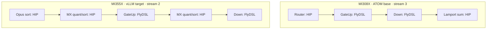

# MI308X 与 MI355X：TP4 decode 实际跑了哪些 kernel？

[图册首页](../../README.md) · [gfx942 的 543 + 424 次调用、两个 prefill 与 mHC 单测](decode-kernels-mhc.md) · [全符号表](trace-compare/symbols.tsv) · [第 10 步逐 stream 顺序](trace-compare/step10-order.tsv)

**先说能证实的结论。** MI308X/gfx942 的 ATOM base 每步 **967 次**；这份 MI355X/gfx950 的 **vLLM + DSpark** 每次验证迭代平均 **2618.4 次**，其中 **2341.4** 次属于 target 的 `execute_model` 范围。不同的不只是 GPU：主查询从 1 行变成了验证 6 行，专家从在线 FP8 变为 MXFP4，执行引擎、软件版本和上下文也不同。并非 MI355X 硬件多执行了 1651.4 次才生成一个 token。

**第三组数据的状态（2026-11-26）：** 名为 `mi355x-atom-dsv41-flash-tp4-100k-1500-trace-20261126.zip` 的文件在此次可访问的工作区、共享盘和报告分支中未定位到。可读取的 `dsv4.1_flash_vLLM_TP4.gz` 没有 `fz_` 前缀；解包后确实是 MI355X vLLM 的四个并发档、16 份 rank trace，不含 ATOM ZIP。**本文不把 vLLM 代填到 MI355X ATOM 栏，也不据 ATOM 的 gfx950 源码推断其实际发射。** 同引擎 ATOM→ATOM 的每步计数、前后顺序与真实 TPOT 仍需那份 ZIP。

## 1. 比较合同：先分清 token、迭代与请求

| 项目 | MI308X / ATOM（gfx942） | MI355X / vLLM（gfx950） | MI355X / ATOM（gfx950） |
|---|---|---|---|
| 实际来源 | 11-24 的 FP4PTPC 24 步 trace；四 rank 均复算 | 上传 tar.gz 内 **C1** 的四份 Kineto trace；实际采集 09-16。设备字段为 MI355X、256 CU，不是从文件名猜 | 指定 ZIP 未取得，待核验 |
| 模型、执行 | `1017-FP4PTPC`；4×80 CU；无草稿；BF16 主 KV、FP8 index；路由专家在线转逐通道 FP8 | 服务名 `DeepSeek-V4.1-Flash`，未证实是同一 revision；4×256 CU；FP8 index，主 KV 配置是 `auto`；日志为 `AITER_MXFP4_BF16` MoE | 未知 |
| 版本 | ATOM `5f6bdb75`、AITER `ad0d5e20`、ROCm 7.2.4 系列 | vLLM `86973da96e` **加本地 MXFP8 修改**；AITER `0.1.21.post1`、Torch `2.12.0+rocm10.0.0` | 未知 |
| Profile 请求 | 100000 输入 / 24 输出；命中 89984；两个 prefill + 24 个 base decode 标记 | 350000 / 512，命中计数 349952；开 CSA，DSpark 草稿 5、synthetic acceptance length 3.51；首个内容后再跳过 5 次迭代，**只抓 20 个 decode**。另有 C4/C16/C32，不混入 | 文件名暗示 100K/1500；不能凭文件名确认 profiler 窗口、DSpark 或 cache |
| 未开 profiler 的客户端结果 | 另跑 100K→1500，四请求中位 **TTFT 627.613 ms、TPOT 7.490 ms、E2E 11.886 s** | 同包、预热后的**一个** C1 请求：首个内容 **506.536 ms**，**TPOT 3.336 ms/输出 token、E2E 2.211 s**；零抢占 | 无实测值 |

这里的 TPOT 均按 `(E2E − 首个内容时间)/(输出数 − 1)`。vLLM 的 unprofiled 指标增量为 146 次 draft、730 个草稿 token、367 个接受、512 个实际输出。按整条请求算的 **512/146 ≈ 3.51 个输出/draft 轮次**，不表示每次都接受 3.51 个草稿，也不是 profiler 那 20 次的逐步接受数。不能用 3.51 或标记中的 6 去除 kernel 次数，伪造实测的每输出 token 计数。也不能拿开启 profiler 的 vLLM 请求 **45.075 s** 当服务性能。

## 2. 一轮有几次？是哪一段发的？

下表为 **rank 0**。`GPU ms` 是设备事件 duration 的和，不是关键路径或请求耗时。`target` 包含主模型验证的 graph 和该 CPU 标记内的辅助工作；`draft graph` 的归属有 Python 调用栈证据，不是根据“多出三个专家”倒推的。

| 采样区间 | 实测原始事件数 / 分母 | 次/迭代 | GPU ms/迭代 | 怎么认出来的 |
|---|---:|---:|---:|---|
| gfx942 ATOM：decode 标记内 | 23208 / 24 | **967** | **8.349** | `decode[bs=1 tok=1 d=1]` → 同线程 HIP launch → 唯一 correlation 的 GPU kernel；不含 prefill 或标记外采样 |
| gfx950 vLLM：target graph | 44500 / 20 | **2225** | 13.655 | 标记 `execute_context_0(0)_generation_1(6)` 内；每个 graph launch 的父栈含 `model_runner.execute_model` |
| gfx950 vLLM：target 标记内的图外工作 | 2328 / 20 | **116.4** | 0.297 | eager 准备/拷贝等；18 轮 116 次，另两轮 120 次。平均的小数不是“半发 kernel” |
| **gfx950 vLLM：target 小计** | **46828 / 20** | **2341.4** | **13.952** | 主模型口径；每轮 1 请求验证 6 行，仍不是 base BS1/S=1 |
| gfx950 vLLM：draft graph | 4080 / 20 | **204** | 1.353 | target 标记外，父栈 `sample_tokens → speculator.propose → run_fullgraph → replay`；每轮一张图 |
| gfx950 vLLM：其余标记外工作 | 1460 / 20 | **73** | 0.500 | 含采样、草稿上下文准备、拷贝等；不能全算作 draft 模型层 |
| **gfx950 vLLM：整个受控窗口** | **52368 / 20** | **2618.4** | **15.804** | 四类不重叠且穷尽；每个 rank 独立核对，**不把四卡相加** |

gfx942 标记内有 **53** 个不同完整设备符号；gfx950 vLLM target 有 **90** 个，其中 target graph 72 个；整个窗口共 **123** 个。符号数不等于模型算子种数：一个模板特化可能是不同符号，一个通用符号也可能服务多个投影。vLLM 各 rank 调用数相同，但全窗口 GPU duration 和分别为 **15.804 / 32.245 / 31.828 / 33.001 ms/迭代**；只报 rank 0、把四卡加起来或取最慢卡，都不能直接得到 TPOT。

## 3. 按算子看：实现替换还是额外工作？

每格为 **调用数 / GPU ms**，rank 0；左列每一个 base decode，右列每一个 target 验证（含 target 图外）。不是同样的矩阵 M、上下文长度和量化：这张表用来对 dispatch，不作同形状速度排名。

| 功能 | gfx942 ATOM base | gfx950 vLLM target | 区别 |
|---|---|---|---|
| mHC | Triton `main` 80/0.679、`reduce` 80/0.801；独立 HIP `post` 3/0.013 | AITER HIP `fused_post_pre_gemm_sqrsum` 77/0.386、`pre_gemm_sqrsum` 2/0.010、`pre_big_fuse` 79/0.400、独立 `post` 6/0.028；Triton `pre_mix` 79/0.367、`hc_head_reduce_store` 80/0.390；TileLang prenorm/gates 各 1 | 按这些标识可辨的 mHC 符号为 **163/1.494 vs 325/1.603**。外置 norm、ATen 操作和输出边界不同；gfx950 vLLM **不是一发 generic HIP Mega-mHC**，不可用它替代上一页的同卡 A/B |
| 主 sparse attention（主体） | 不分片双源 2/0.077；partial 38/0.424 + combine 38/0.204，共 **78/0.706** | `_sparse_attn_decode_gfx950_partial_kernel` 40/0.418 + `_sparse_attn_decode_reduce_kernel` 40/0.205，共 **80/0.623** | 两边核心均有 **Triton** 定义；分片覆盖的层数不同。另有 draft graph 3 对，不能算进 target 的 40 对 |
| Indexer 打分 | `_gluon_deepgemm_fp8_paged_mqa_logits_preshuffle` **8/0.046** | 同名（去 `.kd`）**8/0.342** | 都是 **AITER/Gluon**；验证行数与可见历史不同。不能把 0.342/0.046 解释成硬件慢了多少 |
| Indexer 选择 | AITER HIP radix 4/0.266；FlyDSL compact-512 4/0.101、块 2048 1/0.022 | vLLM 原生 `topKPerRowDecode512DeviceLengthAware<…,false>` 8/0.247 + `<…,true>` 8/0.116；另有块算分、候选掩码与存储等 | **9 发**明确的 942 selector vs **16 发**明确的 950 行级 split/merge；辅助核集合不同，不等于完整 indexer 的等价 9 vs 16 |
| MoE router | `aiter::topk_gating_kernel_opt` **40/0.312** | `vllm::moe::topkGatingSoftplusSqrt<6,384,…>` **40/0.462** | 都是选专家的原生 kernel，不是选历史行；draft graph 另有 3 个 router |
| 专家 Gate/Up + Down | `moe_2stage_gateup_batch1_0` 与 `moe_2stage_down_batch1_0` 各 40，**80/1.154** | `mfma_moe1_silu_mul_afp8_wfp4…` 与 `mfma_moe2_afp8_wfp4…` 各 40，**80/0.978** | 两边专家主体均为 **AITER/FlyDSL**，并非一边 Triton 一边 HIP。942 是每通道 FP8 专家 batch1；950 是 FP8 激活 / FP4 权重，额外有 Opus sorting **40/0.435**、fused MX quant + sort **80/0.374** |
| Q/K、RoPE 与缓存 | `fused_qk_rmsnorm_group_quant_kernel` 40/0.190；`_rope_window_kernel` 40/0.203 | vLLM 原生 `fusedDeepseekV4QNormRopeKVRopeQuantInsertKernel` **40/0.192** | 950 把更多操作并入一个名字；不代表两边输入格式、计算量都相同。输出侧 inverse RoPE 仍各 40 次 |
| Dense | 通用 `kernel_gemm_0` **130/0.908**；`Cijk_*` **85/1.045** | `_mxfp8_linear_kernel` **170/1.200**；`Cijk_*` **124/1.034** | 前者无法逐发映射；后者 MXFP8 linear 有 Triton 定义及 eager 栈。不要把两列都直接标成 AITER 自有 GEMM |
| TP reduce | `aiter::lamportAllReduceWaveSplit` **81/0.708**；另有 allgather-lastdim 3/0.117 | `aiter::cross_device_reduce_1stage` **81/0.697**；另有 RCCL 通信 | 类似的全模型位置与次数，具体算法不同；collective 时长含等待 |

## 4. 到底多少 Triton、Gluon、FlyDSL、HIP？

rank 0 的**每迭代调用数**。每列互斥、穷尽；0 指这个口径未识别到，不代表该库完全没有调用。AITER 是库，不是语言；`hipGraphLaunch` 是 host 提交方式，不能把里面的所有设备节点都算成「用 HIP C++ 写的」。`.kd` 是设备符号后缀，也不是语言。

| 实现归属 | gfx942 ATOM decode | gfx950 vLLM target | gfx950 vLLM 整轮（含 draft 等） |
|---|---:|---:|---:|
| AITER 原生 HIP | 290 | 458 | 497 |
| vLLM 原生 HIP | 0 | 96 | 111 |
| AITER Triton | 160 | 0 | 0 |
| ATOM Triton | 203 | 0 | 0 |
| vLLM Triton | 0 | 589.2 | 653.2 |
| Inductor 生成的 Triton | 0 | 1 | 2 |
| AITER Gluon | 8 | 8 | 8 |
| AITER FlyDSL | 85 | 80 | 86 |
| TileLang | 0 | 2 | 2 |
| ROCm BLAS / Tensile 风格 | 85 | 124 | 135 |
| PyTorch/ATen | 3 | 682 | 786 |
| rocPRIM | 0 | 46 | 49 |
| RCCL | 0 | 2 | 4 |
| ROCm runtime 拷贝等 | 3 | 35.2 | 52.2 |
| **实现未逐发证实** | **130** | **218** | **233** |
| **合计** | **967** | **2341.4** | **2618.4** |

**证据强度。** 直接读取原始设备符号与 eager 的 Python/CPU 调用栈；对特有符号再检查对应源码的 `@triton.jit`、`@gluon.jit`、C++ 设备模板或 FlyDSL 名称生成器。vLLM 对应定义来自可核验的相邻 checkout，不把它冒充包内修改过的确切二进制源码。特别是 `_kernel.kd`：全窗口有 80 次 eager 实例直接落在 `vllm::mxfp8_quantize` / `_mxfp8_e4m3_quantize_triton`，但另外 3640 次在 graph replay 中，没有该逐节点父栈。`kernel.kd` 同理。我们只给调用栈能证实的 eager 实例记 Triton，保留 graph 内这两个通用符号为未知。**未知不是 HIP。**

## 5. 看前后 kernel：同一个 token，前后发射怎样变化？

以下是**原 trace 的同 stream 设备开始顺序**。箭头表示相邻发射，不是跨 stream 数据依赖。不同 GPU、引擎的 stream ID 也不是对应关系。用 [代表性第 10 步](trace-compare/step10-order.tsv) 查细节：总共 967 + 2618 条，按 `engine,stream,stream_ordinal` 排序，保留时间、时长、target/draft/aux 角色和稳定的 `symbol_id`。

| 看哪里 | gfx942 ATOM | gfx950 vLLM target |
|---|---|---|
| 专家 | stream 3：`router → GateUp → Down → Lamport all-reduce`。`router → GateUp → Down` 在 24 步出现 **960** 次，即 40 次/步 | stream 2：`Opus sort → fused MX quant/sort → GateUp → fused MX quant/sort → Down`。中间的 `quant/sort → GateUp → quant/sort` 在 target graph 中出现 **800** 次，即 40 次/迭代。不要把另一个 stream 的 router 强行接成紧邻 |
| 稀疏 attention | 第 10 步 stream 3：`_rope_window_kernel → _indices → partial → combine → inverse RoPE`（此段中 partial 的同流序号 77） | 常见的 stream 8 三连是 `_pack_global_topk_ragged_kernel → gfx950 partial → reduce`，20 个 target graph 合计 **760** 次；第 10 步可见 `partial → reduce → inverse RoPE` |
| mHC 与 TP | stream 3：`Lamport sum → mHC main(HAS_POST_1) → mHC reduce`，合计 **1848** 次，恰是 77×24 | stream 8：`one-stage sum → HIP fused GEMM+sqrsum → HIP big_fuse` 出现 **1480** 次；`HIP big_fuse → Triton pre_mix → Triton head_reduce_store` 出现 **1580** 次。另有非此排列的边界，不用一个例子代替全部 |
| 索引 | 第 10 步 stream 3：`per-group quant → _scale_indexer_weights_kernel → Gluon logits → radix Top-K → kernel_gemm_0`，其他层也可接 compact 选择 | 第 10 步 stream 8：`Gluon logits → Top512 split(false) → merge(true) → _compute_topk_lens_kernel`；候选分支还观测到 `mask_candidates → split → merge` |

想查“某个符号前后还有没有别的组合”，用 [neighbors.tsv](trace-compare/neighbors.tsv) 查三元组及出现次数，再用 [symbols.tsv](trace-compare/symbols.tsv) 把 ID 还原成完整模板名。邻居按同 stream、同迭代计算，不跨边界补造 predecessor/successor。vLLM 的 `execute_model` 和 `speculator.propose` 各有 20 次 graph launch；每个 host launch 可对应成百上千个设备节点，**不是一次 launch 就只算一次 GPU kernel**。

## 6. 哪些结论能用于优化？

- **要同引擎比较芯片**：需要 gfx950 ATOM 的原始 trace 和未开 profiler 的 C1。到位后先对齐 checkpoint revision、专家/主 KV/index dtype、TP/EP、DSpark、prefix hit、M、采样窗口和 profiler 设置，再比较 ATOM 的 mHC、MoE、attention 与通信。不能拿 vLLM 的混合 mHC 路径回答“MI355X ATOM 默认开了 HIP 吗”。
- **要优化 gfx942 TPOT**：先看 967 次的 base 步，尤其 1.481 ms 的 Triton mHC 主体、两发专家、索引选择与 TP 等待。已有[同卡 mHC 单测](decode-kernels-mhc.md)显示 gfx942 generic HIP 比 Triton 慢；本页 gfx950 vLLM 不是该单测的反例。
- **要优化长输入 TTFT**：看 [gfx942 两个 prefill chunk](decode-kernels-mhc.md) 的实测。gfx950 vLLM 包按设计在开始生成后才开 profile，**没有 prefill GPU window**；不能拿它的 decode 符号耗时填一列 gfx950 prefill，也不能把客户端 TTFT 解释为其中某一发 kernel。

## 7. 可复核的材料

| 文件 | 用途 |
|---|---|
| [四 rank 摘要](trace-compare/summary.json) | 各 rank 原始压缩 trace SHA、GPU 型号、标记数、按阶段调用数和 `ms/iteration`；rank 0 附完整家族与实现汇总 |
| [逐符号 TSV](trace-compare/symbols.tsv) | 完整符号、scope、总次数、每步次数、时长、实现归属和依据；同名符号可以在不同 scope 出现 |
| [逐流顺序](trace-compare/step10-order.tsv) · [全窗口前后邻居](trace-compare/neighbors.tsv) | 定位单次发射和反复出现的前后组合；公开的是派生事件清单，不含请求或张量内容 |
| [复算脚本](trace-compare/compare_traces.py) | Python 3.11 标准库。传入 `--atom-trace-dir`（gfx942 的四 rank 目录）、`--vllm-dir`（解包并含 `c1/`、`capture_validation.json` 的目录）、`--out`。唯一 correlation、graph 父栈、分母和 rank 文件清单均有断言 |

vLLM 上传包 SHA-256：`8265c656ce5421ef2c518d1deafdc81561ee4c18f595636f3dc93af058221444`，包内 C1/rank0 SHA：`6ad59015046d9e5bb386ee6f01013f17336ee4d0db98ee23d72cfc3c883a5e21`。对应源码示例：[vLLM mHC Triton](https://github.com/vllm-project/vllm/blob/1c4211fb29e55c4083bbb19dac2fbaa195625884/vllm/model_executor/kernels/mhc/triton.py)、[gfx950 sparse attention](https://github.com/vllm-project/vllm/blob/1c4211fb29e55c4083bbb19dac2fbaa195625884/vllm/v1/attention/ops/rocm_aiter_mla_sparse.py)、[vLLM 原生 Top-K](https://github.com/vllm-project/vllm/blob/1c4211fb29e55c4083bbb19dac2fbaa195625884/csrc/sampler.cu)、[AITER FlyDSL MoE 名称生成器](https://github.com/ROCm/aiter/blob/66ec1adad26423408d0fd776e061efcf6fbc9a39/aiter/ops/flydsl/kernels/mixed_moe_gemm_2stage_common.py)。